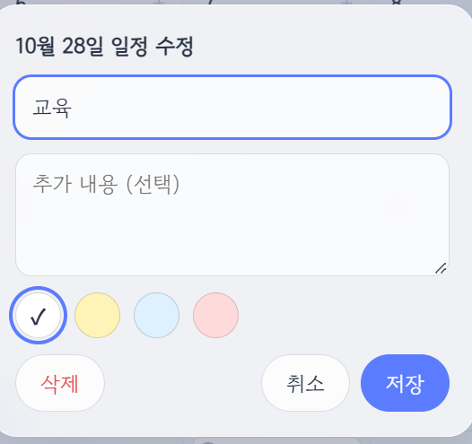

# 일정 플래너

월간 달력에 일정을 메모처럼 붙여 관리하는 웹 플래너입니다. HTML, CSS, JavaScript만으로 만들었고, 설치나 빌드 없이 브라우저에서 바로 실행됩니다. PC와 모바일 모두에서 쓸 수 있습니다.



## 주요 기능

- **월간 달력** — 이전/다음 달 이동, `오늘` 버튼, 좌측 월 바로가기, 모바일에서는 좌우 스와이프로 월 이동
- **일정 추가·수정·삭제** — 날짜를 눌러 제목, 추가 내용(선택), 색상을 입력
- **기간 일정** — 시작일과 마지막 일을 지정해 여러 날에 걸친 일정 등록
- **메모 색상** — 흰색, 연한 노랑, 연하늘색, 연한 빨강 중 선택
- **완료 체크** — 일정별로 완료 표시
- **드래그 앤 드롭** — 일정을 끌어서 삭제 영역에 놓으면 삭제
- **공휴일 표시** — 2026~2027년 한국 공휴일 포함
- **내보내기/불러오기** — 일정을 JSON 파일로 백업하고 복원. 불러올 때 `합치기`(중복 없이 추가)와 `덮어쓰기`를 선택
- **자동 저장** — 브라우저 LocalStorage에 저장되어 새로고침해도 유지
- **반응형 화면** — 데스크톱은 가운데 창, 모바일은 아래에서 올라오는 시트로 입력창 표시

## 사용 방법

1. 저장소를 내려받습니다.
   ```
   git clone https://github.com/ekdud942-cloud/planner-.git
   ```
2. `index.html`을 브라우저로 엽니다.

## 파일 구조

```
├── index.html    # 화면 구조
├── style.css     # 스타일
├── script.js     # 달력 렌더링, 일정 관리, 저장, 내보내기/불러오기
├── holidays.js   # 공휴일 데이터
└── image.png     # README용 화면 이미지
```

## 공휴일 데이터 수정

[holidays.js](holidays.js)에 `"YYYY-MM-DD": "공휴일 이름"` 형식으로 들어 있습니다. 설날, 추석, 부처님오신날, 선거일, 대체공휴일은 해마다 달라지거나 정부 발표로 바뀔 수 있으니 필요하면 직접 고치거나 추가하세요.

## 기술 스택

- HTML5
- CSS3
- JavaScript (ES6, 외부 라이브러리 없음)
- Google Fonts (Gowun Dodum)
